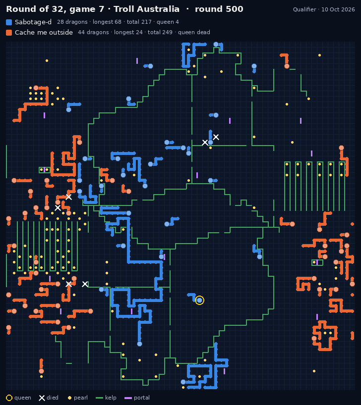
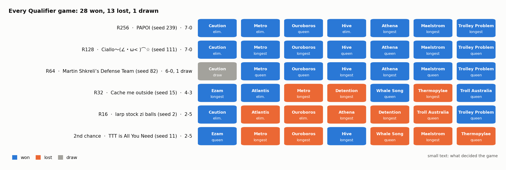
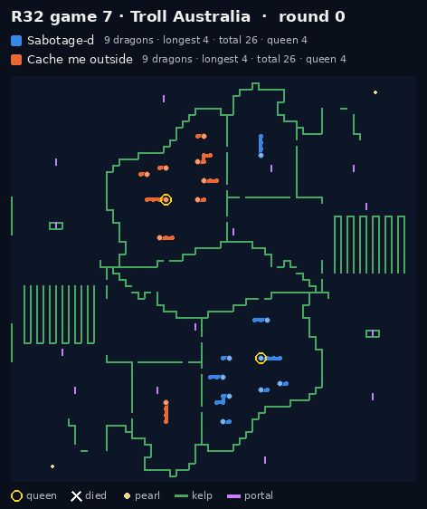

# Sabotage-d · UNSW Battlecode 2026

**Top 16 of 280 in the Qualifier.** Team Sabotage-d's write-up for UNSW Battlecode 2026: the bot, the tools we
built, the data, and what we learned.

*The game that put us in the top 16: Round of 32, game 7, at 3-3. Cache me outside (orange) finished with more
total length, 249 to 217. Our queen (gold ring, bottom centre) was alive at length 4, and theirs had been dead since
round 151. Queen length is the first tiebreak.*

## Results

| Event | Result |
|---|---|
| **Qualifier**, 10 Oct | **top 16** of 280 · seed 18 · beat seed 15 4-3 in the Round of 32 · then 2-5 against seed 2 and 2-5 in the second-chance bracket · 28 games won, 13 lost, 1 drawn |
| **Ladder** | peak rating 2334 · 2252 at seeding (20th) |
| **Sprint**, 1 Oct | seed 18 of 591 · Round of 64 |

## The short version

- **A swarm.** Split to 64 dragons early, let each one map the board on its own, and ram only when the trade pays.
  By round 100 of that game 7 we had 64 dragons to their 14.
- **A safe queen.** Under the 1 Oct rules the longer queen wins at round 500, and a dead queen counts as 0. Our
  queen has her own rules and, in the final build, her own escape search. In the Qualifier she was alive at the end of
  18 of our 42 games, against 10 for the opponents' queens. Queen length decided 15 games, and **we won 12**.
- **One long dragon at the end.** Short dragons die next to the team's king to feed it, and from round 460 every
  dragon except the queen gathers at the king.
- **What we lacked.** Against the top-16 seeds the queens cancelled out, and the longest dragon decided 10 of the
  21 games. We lost 8. The best of those teams grew one dragon from the middle of the game, up to 205 long.

## The write-up

| Page | What is in it |
|---|---|
| [The game](docs/game.md) | the rules in brief, and what they push a bot towards |
| [How the bot works](docs/bot.md) | one dragon's turn, the swarm, staying alive, sonar, the endgame, the C++ port |
| [Keeping the queen alive](docs/queen.md) | how our queens died, every queen rule, the smart-queen searches, the numbers |
| [The Qualifier](docs/qualifier.md) | every match and every game, with pictures |
| [The ladder](docs/ladder.md) | our rating, ladder maps against unseen maps, the ladder-only builds |
| [How we tested](docs/testing.md) | paired A/B tests, the cloud runner, CPU, replays |
| [Version history](docs/history.md) | from the first Python bot to the Qualifier build, with the numbers |
| [What we learned](docs/lessons.md) | eight lessons for next year |

## What is in this repo

| Folder | |
|---|---|
| [bot/](bot/) | our final general bot: C++, the smart-queen build. `g++ -O2 -std=c++20 -o bot *.cpp` |
| [tools/](tools/) | the replay reader, the renderer for every picture here, the stats and chart scripts, the bracket odds |
| [data/](data/) | the Qualifier games and bracket, our ladder rating, the queen A/B test |
| [docs/](docs/) | the write-up and its images |

The replay pictures are drawn from the official replay files by [tools/render_replay.py](tools/render_replay.py),
and the charts from [data/](data/) by [tools/make_charts.py](tools/make_charts.py). Blue is always us, orange the
opponent.

## Team Sabotage-d

Neel Gupta · Ananya Agarwal · Kartik Jeengar · Arnav Garg

Thanks to the UNSW Battlecode 2026 organisers for the game, the engine, the visualiser and the public replays, and
to every team we played.
