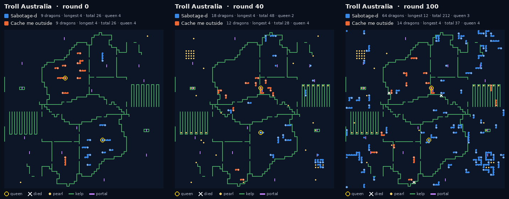
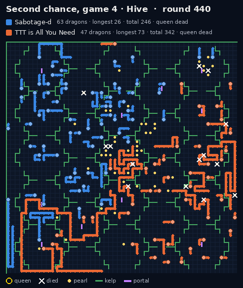

# How the bot works

Our bot is one C++ program of about 9,700 lines ([bot/](../bot/)). Every dragon runs its own copy, and a copy knows
only what its own dragon has seen and what its teammates have told it by sonar. This page explains the strategy;
[bot/README.md](../bot/README.md) maps it onto the files.

## One dragon's turn

Each turn a dragon reads its 7 x 7 window, adds what it sees to its own map memory, and then works through a fixed
list:

1. **Kill?** Ram an enemy head, but only when the trade pays.
2. **Feed?** Late in the game, die beside a longer friend so that it eats the pearls we drop.
3. **Split?**
4. **Move.** Score every candidate step on food in reach, how long we can keep moving afterwards, enemy threat, room,
   friends' exits, lanes and portals. Then the queen's last checks, then sprint if there are free steps.

Almost everything is a parameter with a default (`params.hpp`, about 700 of them). Every rule was tested on
its own switch before it stayed on.

## The opening: become a swarm

Splitting is the economy. A dragon that has eaten a little splits, and each half goes off to eat on its own. The
dragons spread out by exploring wherever the team has not been yet, and the cap of 64 dragons fills quickly.

*Round of 32, game 7 (Troll Australia). Both teams start with 9 dragons. By round 100 we have 64, the cap, and
Cache me outside has 14. Our total length is 212 to their 37.*

## Staying alive

Most deaths are self-inflicted: a head walks into a dead end, its own body, or a tile an enemy head can also
reach. Every candidate step is checked for:

- **Enemy reach.** Every tile an enemy head in view could ram before our next turn is a threat.
- **Survival depth.** After this step, can the dragon keep moving for long enough, given where its own body will
  be? This search runs over the remembered map, not just the window.
- **Dead ends.** One-way passages and pockets are known. A dragon only walks in if it can get out, or if it can
  split its way out backwards.
- **Friends' exits.** A step that blocks a friend's way out scores worse.

Sprints are used to escape: the free steps let a long dragon jump out of an enemy's reach in one turn.

## Talking by sonar

A sonar beam is 64 bits, one per direction, delivered to the first dragon part it hits. Most of the ideas we tried
for sharing the map lost: the swarm crowded together and starved. What stayed:

- **the king's beacon:** which dragon the team is feeding, with its id, so that the whole team agrees on one;
- **"a queen is dead":** ours or theirs, which changes how much the rest of the game is worth risking;
- **the contact estimate:** how much the two swarms have met. This drives the **clock switch**. Where the swarms mix,
  everyone keeps eating until late and feeds the king only at the end. Where they never meet, feeding starts much
  earlier, from about round 200.

## The endgame: one long dragon

The second tiebreak is the longest dragon, and a dead dragon drops a pearl on every second segment. So late in
the game short dragons **feed**: they die next to the team's **king** so that it eats the pearls they leave. From
round 460 comes **the gathering**. Every dragon except the queen walks to the "crown", the king the beacons agree
on, and feeds it.

*Second chance, game 4 (Hive). Our longest dragon is 26 at round 440, 49 at round 460, 79 at round 470 and 85 at the
end. We won the game on the longest dragon, 85 to 54.*

Feeding converts total length into one long dragon at a loss: half of each fed dragon is lost. Total length is
only the third tiebreak, so this is usually a good trade.

## The queen

Queen length is the first tiebreak, so the queen gets her own rules. She has a home to stay near on big maps, a
"vault" (a sealed space) to hide in, and she never feeds. She keeps off portals when they are risky, and an escape
search runs whenever an enemy is in view. All of this is on its own page: [queen.md](queen.md).

## Knowing the map

- **Memory.** Every tile, pearl, countdown and kelp or portal edge a dragon has seen stays in its memory. Routes
  and survival searches run over that memory.
- **Spawn rates.** A tile's countdown shows how long until it next spawns a pearl. From the countdowns a dragon
  sees, it estimates how fast each tile spawns, and plans its route over the richest water.
- **Lanes.** A dead-end lane with food is farmed as a relay. A dragon eats its way in, splits at the tip, and the
  child walks back out. This is on for maps under 4,000 tiles.
- **Recognising ladder maps.** The bot can tell when it is on one of the ladder maps, exactly: every edge and timer
  it has seen must match. In this build that is used for only two things, Trophy's spawn rates and the opening on
  Around UNSW. [ladder.md](ladder.md) has the rest of that story.

## CPU

The bot started in Python. On 27 Sept the team ported it to C++, function by function, built on the same arithmetic
as Python. The two versions gave identical replies on 586,984 recorded turn inputs and played identical games.

The port cut the cost of a turn from about 21M CPU points to about 3M, against a limit of 100M. We expected to
spend that headroom on much deeper searches. In tests, ten times the search budget changed 4 games out of 198. The
gains came from better rules, not deeper search. The smart-queen searches added at the end stop on node caps and a
clock, and stay around 4M points a turn on average.
