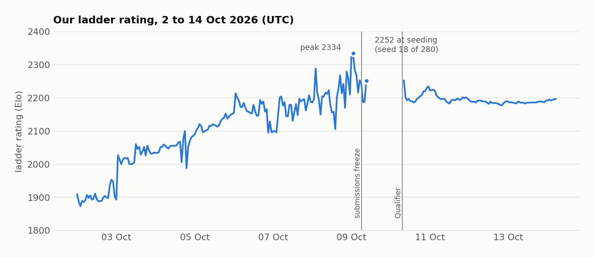

# The ladder

| Measure | Value |
|---|---|
| peak rating | **2334** (9 Oct, 00:59 UTC) |
| rating at seeding | **2252**: 20th on the ladder, **seed 18** of the 280 eligible teams |
| rating on 14 Oct | 2196 (22nd) |
| games on the team page | 19,141 won, 13 drawn, 14,594 lost |
| earlier | #3 with v1 (22 Sept); #7 at 2001 (27 Sept); seed 18 of 591 at the Sprint (1 Oct) |

The chart starts on 2 Oct; the rating history on the team page begins on 1 Oct. The break in the line on 9-10 Oct
is the time between seeding and the Qualifier, when our rating did not move.

## The ladder is not the tournament

The ladder plays a public pool of 17-18 maps. The tournaments play maps nobody has seen. A rule that knows a
ladder map raises the rating, but it cannot help in a tournament. We learned that early:

- **v2.5** removed every map table: 79-81 against v2.4, which had them.
- **v2.12** beat v2.11 274-166 on the known maps, but lost 57-63 on unseen ones.

So the main bot stayed general. The only map-specific things in it are Trophy's spawn rates and the opening on
Around UNSW.

## Recognising a ladder map

From 8 Oct the bot could recognise the ladder maps.

- **How it matches.** Each dragon compares everything it has seen against the 18 stored layouts: every kelp and
  portal edge, and every pearl timer. A map counts as recognised only when all of it matches.
- **Re-checking.** The check runs again every turn, and the recognition is undone at the first mismatch.
- **What it unlocks.** Once a map is recognised, a build can load that map's walls and portals or its true spawn
  rates, or switch a rule on for that map.
- **Look-alike maps.** On a map that only looks like a ladder map, a wrong recognition can last a few dozen
  rounds. Undoing it has to take the loaded walls back out, or the dragon keeps walls that are not there. One
  build was 4 games worse over 44 on look-alike maps before that fix and 2 worse after it.

## Ladder-only builds

For the last day before seeding we made separate **ladder builds** with rules for particular ladder maps:

- **Queen near home:** weakhold and Autarky.
- **True spawn rates:** Australia.
- **Every wall, portal and spawn rate known:** Tower Defense, Devil, Queen of Spades, Maze, Islands, Schooltime and
  Stronghold.
- **Walls and portals:** Portals.

Each rule was tested on its own map, and it stayed where it helped or did no harm:

| Map | Local win rate with the rule, minus without (percentage points) |
|---|---|
| Maze | +31% |
| weakhold | +28% |
| Australia | +24% |
| Tower Defense | +17% |
| Queen of Spades, Islands, Schooltime | +16% each |
| Devil | +12% |
| Autarky | +3% |
| Portals | 0 |
| Stronghold | +17% (no longer in the ladder pool; kept in case it came back) |
| Stripes, Default, Slithery Fight, Trauma, Around UNSW | worse or no better: **left off** |

In general, knowing the spawn rates without the walls made things worse; Australia, with spawn rates only, was the
exception.

On the ladder, we compared our per-map performance before and after the change, on the maps with a rule and on the
maps without one:

| | maps with a rule | maps without | all maps |
|---|---|---|---|
| before (8 Oct, 20:48 to 9 Oct, 00:56 UTC) | 2215 | 2280 | 2243 |
| after (from the freeze) | 2320 | 2216 | 2274 |

On the maps with a rule, performance went up by 105. On the others it went down by 64, which is the ladder moving
under us. The difference, about **+169 ± 53**, is what the rules were worth on their own maps. Spread over the
whole pool that is about +90 on the team rating, which is the average of the per-map ratings.

The build that was active at the freeze, v3.9zq-exp, was the smart-queen bot plus these rules. A recognition needs
a ladder map of the same size, and the views have to match it. On 9 of the 13 Qualifier maps that was impossible:
seven have sizes no ladder map has, and on Caution and Whale Song no 7 x 7 view matches a ladder map of their size.

The other four share a size with a ladder map, and parts of them match it:

- Detention matches Schooltime in places.
- Ezam shares 82% of Maze's edges.
- Thermopylae matches Around UNSW and Australia in places.
- Troll Australia shares 95% of Australia's edges.

On those four a dragon could take the map for the ladder one until it saw a difference. The recognition is then
undone, which is what the undo fix was for. The replays can't tell us whether that happened. The bot in this repo
is the general smart-queen bot without the ladder-only rules.
