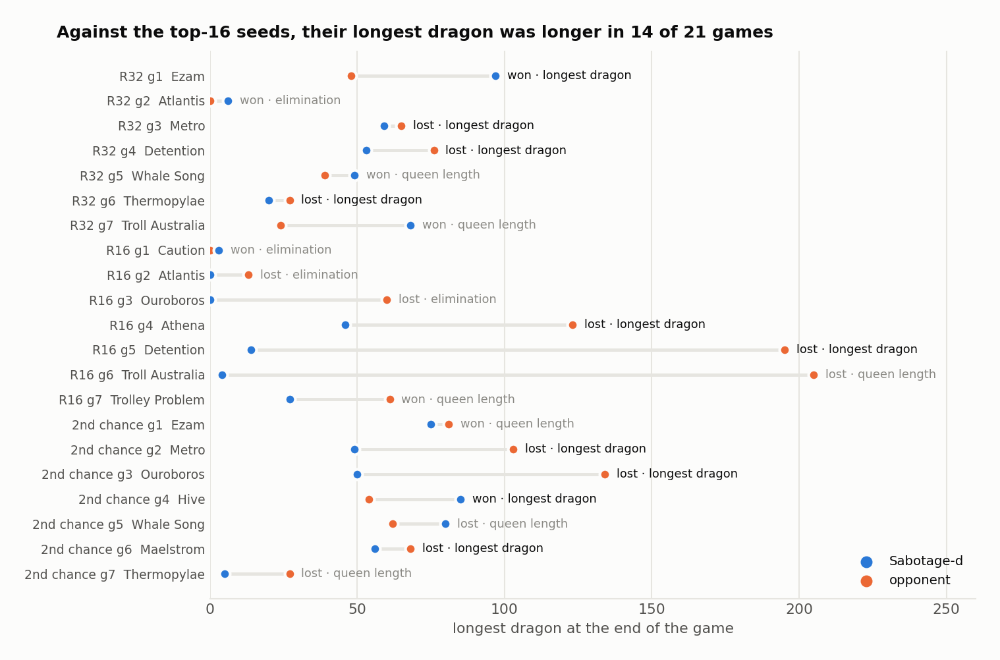

# What we learned

## 1. Read the tiebreaks first

The order at round 500 (queen length, then the longest dragon, then total length) decides what a good bot looks
like. When the queen rule arrived on 1 Oct, our best bot lost its queen in 116 of 120 test games. Protecting her
became most of our work for the rest of the season, and it paid. Queen length decided 15 of our 42 Qualifier games,
and we won 12 of them, including the game that put us in the top 16.

## 2. The second tiebreak matters just as much

Against the three top-16 teams we played, the queens cancelled out: theirs survived as often as ours. Then the
longest dragon decided 10 games, and we won 2. Those teams grew one dragon from the middle of the game. The seed-2
team finished with 123, 195 and 205. Our long dragon came from feeding, and from the gathering at round 460, which
loses half of every dragon it feeds. It was enough against most of the field and nowhere near enough against the
best.

If we did it again, we would plan for a long dragon from the middle of the game, and test it against bots that do
the same.

## 3. Test on maps you have not seen

Twice a version looked better on the known maps and was worse on new ones (v2.4's map tables, and v2.12). The
ladder rewards knowing its maps, and the tournaments are played on maps nobody has seen. Our main bot stayed
general. The map-specific rules lived only in separate ladder builds, and we measured what they were worth on the
ladder ([ladder.md](ladder.md)).

## 4. One switch at a time, paired, hundreds of games

A single 80-game run moves about ±11 points by chance. Most of our ideas sounded right and lost when tested
properly:

- sharing the map by sonar;
- a portal "clock";
- staying out of even trades;
- deeper searches;
- an early merge.

Paired games on the same maps, seeds and sides, against several opponents, were the only thing we trusted.

## 5. Small steps beat a rewrite

On 5 Oct we rewrote the bot from seven design documents. v4.0 won 8.3% of its games against the bot it was meant
to replace. Its ideas came back one at a time as switches on the old bot, and only one of them passed.

## 6. Port for headroom, but don't expect search to win

The C++ port made a turn about seven times cheaper, 21M CPU points down to 3M. Ten times the search budget then
changed 4 games out of 198. The gains came from rules we found in replays, not from searching deeper.

## 7. Replays are the best debugger

Two of our worst bugs were found by watching games, not by tests:

- the queen ids hard-coded per side, so in half of all ladder games our queen played as an ordinary dragon;
- queens walking into one-tile pockets behind portals.

The reader in [tools/](../tools/) can rebuild any turn of any replay and feed it back to the bot.

## 8. Write the numbers down

Every version shipped with a short README holding its test numbers. That habit is what made this write-up
possible, a week later, without guessing.
