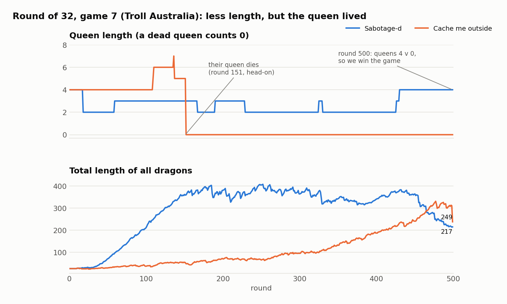
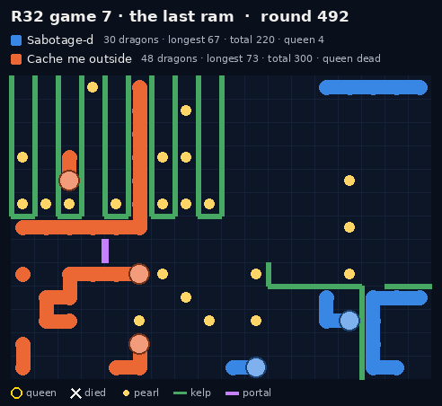
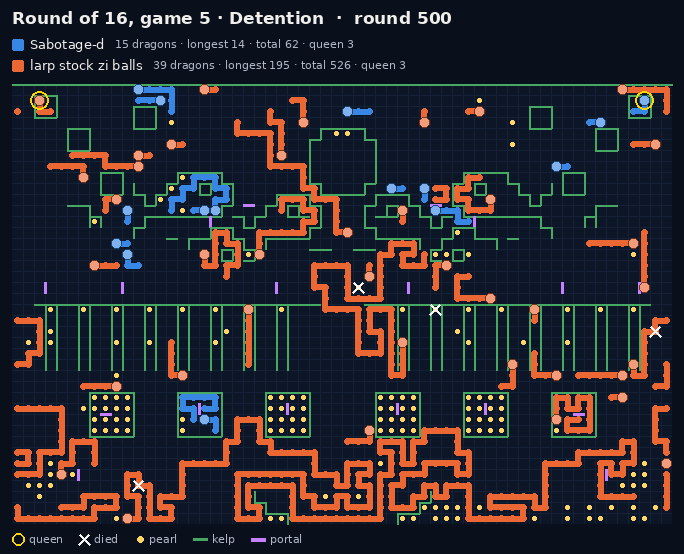
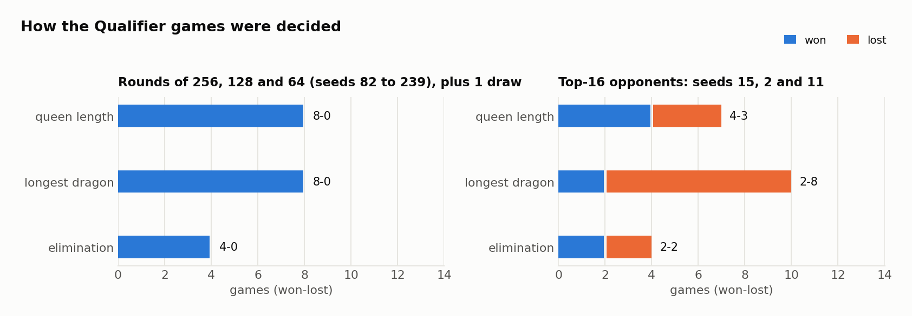

# The Qualifier

**10 Oct 2026, streamed from 6 pm Sydney time.** The Qualifier had 280 eligible teams, seeded by ladder rating after
a last round of autoscrims. It was single elimination, and every match was best of 7 on maps nobody had seen.
Ten places in the Grand Final were on offer: the eight quarterfinalists, plus the two finalists of a second-chance
bracket for the Round-of-16 losers.

We went in as **seed 18**, with a rating of 2252. Our Monte Carlo over the real seeds
([tools/bracket_odds.py](../tools/bracket_odds.py)) gave seed 18 a **41%** chance of reaching the Round of 16. It
gave about 2% of reaching the Grand Final, because the Round of 16 meant seed 2.

## Our run: top 16

| Round | Opponent (seed) | Score |
|---|---|---|
| First round | bye | |
| Round of 256 | PAPOI (239) | 7-0 |
| Round of 128 | Ciallo～(∠・ω< )⌒☆ (111) | 7-0 |
| Round of 64 | Martin Shkreli’s Defense Team (82) | 6-0, 1 draw |
| **Round of 32** | **Cache me outside (15)** | **4-3** |
| Round of 16 | larp stock zi balls (2) | 2-5 |
| Second chance, first round | TTT is All You Need (11) | 2-5 |

Over 42 games we won 28, lost 13 and drew 1.

## Rounds of 256 to 64: 20-0-1

The safe queen and the swarm were enough against the field. In these 21 games our queen was alive at the end of 10
and theirs of 1. Queen length decided 8 of them, the longest dragon 8, and elimination 4, and we won every one. The
one draw was Caution against Martin Shkreli’s Defense Team. In round 24 the last dragons of both teams died, both
queens among them, head-on.

## Round of 32: Cache me outside (seed 15), 4-3

The only upset in our run, and the match that put us in the top 16.

| Game | Map | Result | Decided by | Queens at the end (us v them) | Longest | Total |
|---|---|---|---|---|---|---|
| 1 | Ezam (48 x 24) | **W** | longest dragon | dead (r216) v dead (r400) | 97 v 48 | 215 v 72 |
| 2 | Atlantis (48 x 48) | **W** | elimination, round 406 | dead (r197) v dead (r331) | | |
| 3 | Metro (48 x 48) | L | longest dragon | dead (r175) v dead (r83) | 59 v 65 | 139 v 291 |
| 4 | Detention (60 x 40) | L | longest dragon | 3 v 3 | 53 v 76 | 205 v 306 |
| 5 | Whale Song (64 x 64) | **W** | queen length | 24 v 18 | 49 v 39 | 220 v 182 |
| 6 | Thermopylae (64 x 64) | L | longest dragon | dead (r131) v dead (r373) | 20 v 27 | 27 v 176 |
| 7 | Troll Australia (64 x 64) | **W** | queen length | **4** v dead (r151) | 68 v 24 | 217 v 249 |

### Game 7

Troll Australia is 64 x 64, and both teams start with nine dragons. We split to the cap of 64 by round 100, while
Cache me outside grew slowly and caught up late. Their queen died head-on at round 151. Ours, at length 2 to 4,
stayed out of trouble for the whole game.

*Round 500. Our queen (gold ring, bottom centre) is alive at length 4, and theirs has been dead since round 151.
Cache me outside has more total length (249 to 217), but queen length is the first tiebreak.*

Their best chance was the longest dragon: a 78-long dragon at round 498, against our 67. It would not have been
enough, because queen length comes first. It also did not survive. In round 498 a 4-long dragon of ours sprinted
into its head, and both died.

The whole game, every fourth round:

## Round of 16: larp stock zi balls (seed 2), 2-5

| Game | Map | Result | Decided by | Queens at the end (us v them) | Longest | Total |
|---|---|---|---|---|---|---|
| 1 | Caution (32 x 16) | **W** | elimination, round 19 | 3 v dead (r13) | | |
| 2 | Atlantis (48 x 48) | L | elimination, round 188 | dead (r188) v 2 | | |
| 3 | Ouroboros (56 x 56) | L | elimination, round 286 | dead (r85) v 52 | | |
| 4 | Athena (64 x 48) | L | longest dragon | dead (r102) v dead (r190) | 46 v 123 | 132 v 495 |
| 5 | Detention (60 x 40) | L | longest dragon | 3 v 3 | 14 v 195 | 62 v 526 |
| 6 | Troll Australia (64 x 64) | L | queen length | dead (r227) v 22 | 4 v 205 | 4 v 461 |
| 7 | Trolley Problem (50 x 50) | **W** | queen length | 26 v 21 | 27 v 61 | 73 v 93 |

The second seed played a different game from ours. From the middle of the game they grew one dragon into a giant:
123 on Athena, 195 on Detention, 205 on Troll Australia. On Detention both queens finished in small kelp cells at
length 3, so the longest dragon decided, and we had nothing close.

*Detention, round 500. Both queens (gold rings, top corners) are alive at length 3. Their longest dragon (orange,
filling the lower half) is 195. Ours is 14.*

We still took two games off them. Caution was won by elimination in 19 rounds. On Trolley Problem our queen
outlasted theirs, 26 to 21, although their longest dragon was more than twice ours. larp stock zi balls went on
to the final and lost 4-3 to the top seed, aAah.

## Second chance: TTT is All You Need (seed 11), 2-5

| Game | Map | Result | Decided by | Queens at the end (us v them) | Longest | Total |
|---|---|---|---|---|---|---|
| 1 | Ezam | **W** | queen length | **75** v dead (r397) | 75 v 81 | 241 v 81 |
| 2 | Metro | L | longest dragon | dead (r85) v dead (r300) | 49 v 103 | 203 v 279 |
| 3 | Ouroboros | L | longest dragon | dead (r90) v dead (r103) | 50 v 134 | 221 v 371 |
| 4 | Hive | **W** | longest dragon | dead (r68) v dead (r63) | 85 v 54 | 330 v 217 |
| 5 | Whale Song | L | queen length | 4 v 7 | 80 v 62 | 206 v 142 |
| 6 | Maelstrom | L | longest dragon | dead (r226) v dead (r355) | 56 v 68 | 175 v 114 |
| 7 | Thermopylae | L | queen length | dead (r430) v 7 | 5 v 27 | 32 v 114 |

The pattern again: we lost every game that came down to the longest dragon except Hive. Hive is the game in the
gathering GIF on [bot.md](bot.md). TTT is All You Need went on to the second-chance final and into the Grand Final.

## What decided our games

- **Against the field** our queen and our swarm decided everything.
- **Against the three top-16 teams:**
  - games decided by queen length: 4-3;
  - games decided by elimination: 2-2;
  - games decided by the longest dragon: **2-8**.

  Their queens were as safe as ours (alive at the end in 9 of 21 games against our 8), so the second tiebreak
  decided. Our longest dragon came from a late gathering that starts at round 460. Theirs had been growing since
  the middle of the game. [lessons.md](lessons.md) has more on this.

## Who went to the Grand Final

- aAah (won the Qualifier 4-3 against larp stock zi balls)
- larp stock zi balls
- chat gippy tea
- Cutlery
- Sponge(Albert and Bob)
- forgot to mention
- test4
- WeHaveQuizzes
- SSS and TTT is All You Need, through the second chance

All the data behind this page is in [data/](../data/). Every number comes from the 42 replays, rebuilt by
[tools/qualifier_stats.py](../tools/qualifier_stats.py).
