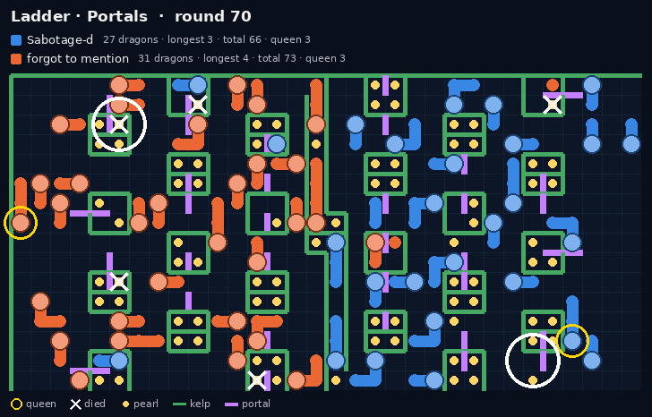
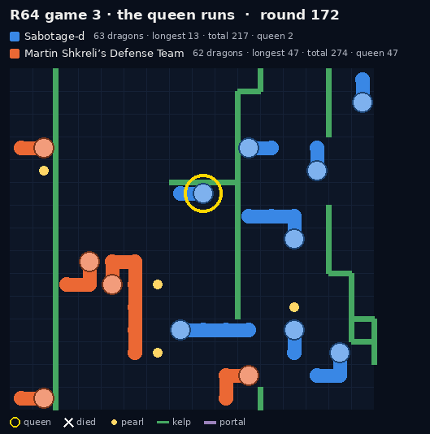
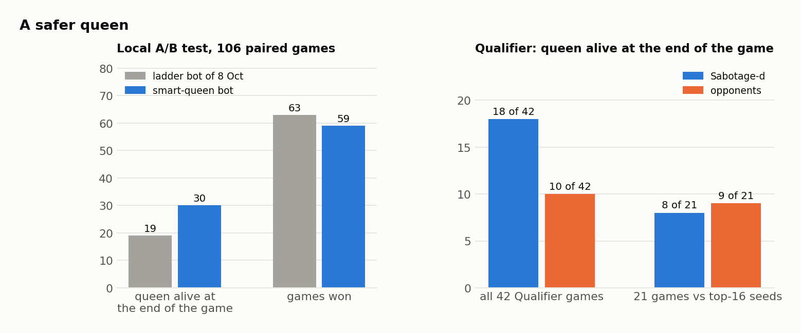

# Keeping the queen alive

## Why the queen decides games

On 1 Oct the rules changed. Dragons 0 and 1 became the two **queens**, and at round 500 the longer queen wins,
before any other tiebreak. A dead queen counts as 0. A queen of length 4 that is still alive therefore beats a
dead queen, whatever else is on the board.

Our best bot at the time (v2.18) had never had a reason to protect one particular dragon. Under the new rules it
lost its queen in 116 of 120 test games. The ladder showed the same thing. On maps under 1,100 tiles, against
teams rated 2300+, the other team's queen was alive at round 500 in about 44% of games and ours in about 2%.

## How queens die

Replays showed two common deaths:

1. **A pocket behind a portal.** A portal can lead into a one-tile dead end. A dragon of length 2 or more that
   goes in cannot turn back, because its own neck fills the only exit.
2. **A head-on with a small enemy.** Two heads that meet both die. Ramming a queen with a 2- or 3-long dragon is a
   very cheap trade for the other team.

*Ladder, 8 Oct, Portals, against forgot to mention. Our queen (gold ring) takes the portal at the lower white ring
and comes out at the upper one, in a tile with kelp on three sides. The fourth side is the portal she came
through, and her own body is in it. Next turn she dies on the kelp.*

## What we built, step by step

| When | Version | Change | Result |
|---|---|---|---|
| 1 Oct | v3.0 | queen-safety package on maps of 1,100+ tiles | 142-98 (59.2%) against v2.18 over 240 games |
| 2 Oct | v3.1 | **bug fix:** the queen ids had been hard-coded per side. On side-swapped maps (half the ladder games) our queen played as an ordinary dragon | +2.8 points against v2.18 |
| 3 Oct | v3.4 | the queen buds off children only while the team has fewer than 20 dragons | +9.3 points against v2.18 |
| 6 Oct | v3.9 | a tether: she pays for every step more than 8 tiles from where she started | +27 over 360 games against a sparring bot |
| 7 Oct | v3.9d-j | no blind corridors, she never feeds, friends never leave her without a legal step, a look-ahead at enemy reach | tested one at a time; the ones that helped stayed |
| 8 Oct | v3.9k-s | small friends guard her, she keeps out of reach, no blind portals and no ramming on small maps, no growth splits after round 200 | 137 of 236 for v3.9l against v3.9k |
| 9 Oct | smart queen | escape search with an enemy in view, portals only as a last resort on maps of 1,100+ tiles, body-aware survival search | below |

## The queen's rules in the final bot

| Rule | What it does |
|---|---|
| never feeds | the queen is never the one that dies to feed another dragon |
| tether | every step more than 8 tiles from where she started costs her score |
| out of reach | while some safe step is out of every enemy head's reach, steps into reach are almost forbidden |
| look-ahead | with enemies in view she works out how soon each of them can reach every tile in view, sprints included |
| corridors | stepping into a one-tile-wide corridor costs her score |
| no ramming (small maps) | on maps under 1,100 tiles she never rams |
| no blind portals (small maps) | on maps under 1,100 tiles she takes no portal whose landing she cannot see |
| no late growth splits (1,100+ tiles) | from round 200 she stops splitting off children, so she keeps her length |
| queen as king (1,100-3,999 tiles) | from round 300 the team feeds her, so the length goes where the first tiebreak counts it |
| friends keep her exits | a friend that sees her never takes a step that leaves her without a legal step. If every step does, it walks into a wall, and its pearls are hers |
| guards | a short friend that sees an enemy head within 5 steps of her closes on it and rams it |
| **smart queen:** escape | with any enemy part in view, she searches her own moves for an escape. The search knows where her own body will be, but it cannot know the enemies' future moves |
| **smart queen:** portals last | on maps of 1,100+ tiles she takes a portal only when no checked ordinary route is safe |
| **smart queen:** body search | "after this step, can I keep moving?" is answered with her body in the right places. Only a complete answer replaces the older estimate |

*Qualifier, Round of 64, game 3 (Ouroboros). A 3-long enemy follows our 2-long queen for 15 rounds, never more
than two steps away. She keeps out of its reach, turns back when it gives up, and finishes the game at length 66.*

## Did it work?

- **Local A/B test** (106 paired games, same maps, seeds and sides, against two sparring bots). Against our 8 Oct
  ladder bot, the smart-queen bot had its queen alive at the end in 30 games against 19. On average she lived to
  round 249 against 189 with the first sparring bot, and to 199 against 149 with the second. Wins were level
  (59 v 63, within noise).
- **Qualifier.** Our queen was alive at the end of 18 of our 42 games; the opponents' queens were alive in 10.
  Queen length decided 15 games, and **we won 12 of them**. That includes the 4-3 decider that put us in the top 16
  ([qualifier.md](qualifier.md)).
- Against the top-16 teams the picture was even: our queen survived 8 of 21 games, theirs 9. Those teams protect
  their queens too, and then the next tiebreak, the longest dragon, decides. That was our weak spot
  ([lessons.md](lessons.md)).

## An experiment: no portals for the queen on long maps

We suspected that on long maps (one side at least twice the other) the queen should never take a portal. We tested
this on top of the ladder bot as `Q_PORT_LONG`, ON against OFF, in paired games:

| Map (long, with portals) | against sparring bot 1 | against sparring bot 2 | queen alive (bot 1) |
|---|---|---|---|
| Stripes | 0 v 6 of 8 | 1 v 3 of 8 | 0 v 0 |
| Dilemma | 8 v 8 of 8 | 0 v 8, 0 v 8 of 8 | 0 v 2 |
| Portals | 5 v 8 of 8 | 3 v 4 of 8 | 0 v 0 |
| Autarky | 5 v 5 of 8 | 3 v 3 of 8 | 6 v 6 |
| Maze | 6 v 6 of 8 | 6 v 6 of 8 | 6 v 7 |
| Trauma | 6 v 5 of 8 | 4 v 3, 4 v 3 of 8 | 6 v 3 |
| Slithery Fight | 5 v 5 of 6 | 3 v 4 of 6, 5 v 6 of 8 | 4 v 4 |

On the small long maps the queen needs her portals to escape: on Dilemma against the second bot the rule turned
16 wins out of 16 into none. On long maps of 1,100+ tiles it was neutral or slightly better. The smart-queen bot's
"portals only as a last resort" uses the same 1,100-tile threshold, for every map shape.
